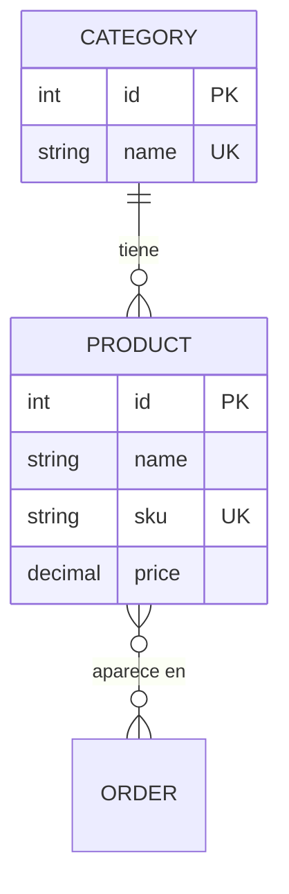

# Modelo ER del emprendimiento · Grupo G1

> Actividad 3 de la sesión 4. Es la base del `schema.prisma` del Lab 2 y de las relaciones del Lab 3.

## Diagrama

## Entidades

| Entidad | Atributos (tipo) | Clave primaria | Únicos / obligatorios / reglas |
|---|---|---|---|
| | | | |
| | | | |
| | | | |

## Relaciones

| Entidad A | Cardinalidad (1:1, 1:N, N:M) | Entidad B | Ejemplo en una frase |
|---|---|---|---|
| | | | |
| | | | |

## ¿Qué se implementa en cada laboratorio?

- **Lab 2:** la entidad principal y una segunda entidad en `schema.prisma`, sin relaciones.
- **Lab 3:** las relaciones y las entidades restantes.
