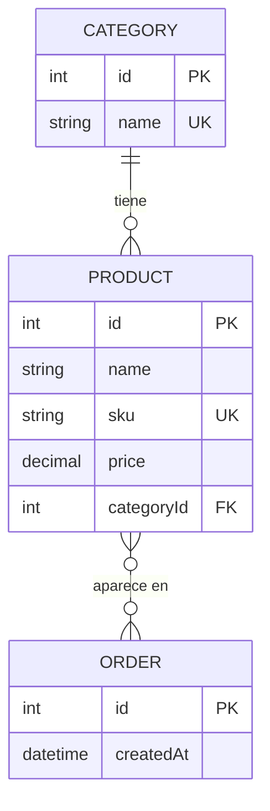

# Modelo ER del emprendimiento · Grupo G1

> Actividad 3 de la sesión 4. Es la base del `schema.prisma` del Lab 2 y de las relaciones del Lab 3.

## Diagrama

## Entidades

| Entidad | Atributos (tipo) | Clave primaria | Únicos / obligatorios / reglas |
|---|---|---|---|
| CATEGORY | id (int), name (string) | id | id autoincremental. name obligatorio y único. |
| PRODUCT | id (int), name (string), sku (string), price (decimal), categoryId (int) | id | id autoincremental. Todos los atributos son obligatorios. sku único. price mayor que cero. categoryId referencia una categoría existente. |
| ORDER | id (int), createdAt (datetime) | id | id autoincremental. createdAt obligatorio, con la fecha y hora de creación por defecto. |

## Relaciones

| Entidad A | Cardinalidad (1:1, 1:N, N:M) | Entidad B | Ejemplo en una frase |
|---|---|---|---|
| CATEGORY | 1:N | PRODUCT | Una categoría puede tener cero o muchos productos y cada producto pertenece a una sola categoría. |
| PRODUCT | N:M | ORDER | Un producto puede aparecer en cero o muchos pedidos y un pedido puede incluir cero o muchos productos. |

## Consideraciones para la implementación

- `PRODUCT.categoryId` es la clave foránea que relaciona cada producto con su categoría.
- La relación N:M entre `PRODUCT` y `ORDER` se implementará mediante una tabla intermedia que Prisma puede gestionar automáticamente.
- La regla de precio mayor que cero debe validarse en el backend.

## ¿Qué se implementa en cada laboratorio?

- **Lab 2:** la entidad principal y una segunda entidad en `schema.prisma`, sin relaciones.
- **Lab 3:** las relaciones y las entidades restantes.
