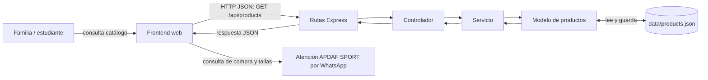

# Propuesta del emprendimiento · Grupo G1

> Actividad 1 de la sesión 1. Propuesta basada en el catálogo público de [APDAF SPORT](https://apdafsport.com/), consultado el 18 de octubre de 2026. Los precios del catálogo pueden cambiar.

| Campo | Respuesta |
|---|---|
| Nombre del emprendimiento | Catálogo y pedidos de uniformes escolares APDAF SPORT |
| Problema que resuelve | A las familias les puede resultar difícil encontrar las prendas autorizadas para cada institución, comparar sus precios y confirmar tallas. El proyecto organiza el catálogo por institución y permite solicitar ayuda para comprar. |
| Usuarios (quién lo usa) | Madres, padres y representantes que compran uniformes; estudiantes que consultan prendas y tallas; personal de APDAF SPORT que administra el catálogo y atiende pedidos. |
| 3 funciones principales | 1. Consultar uniformes y accesorios organizados por institución y categoría.   2. Revisar productos y precios del catálogo, y seleccionar prendas para un pedido.   3. Solicitar asesoría personalizada sobre productos y tallas por WhatsApp. |

**WhatsApp:** canal de atención del emprendimiento: **+593 99 717 4850**.

## Mapa frontend–backend

## Entidades (3) y atributos principales

| Entidad | Atributos principales | ¿Se relaciona con…? |
|---|---|---|
| **Producto** (entidad principal del Lab 1) | `id`, `name`, `institution`, `category`, `price` | Pertenece a una institución; puede incluirse en uno o varios pedidos. |
| **Institución** | `id`, `name`, `description` | Tiene muchos productos de uniforme y accesorios. |
| **Pedido** | `id`, `customerName`, `contactPhone`, `status`, `productIds` | Lo realiza un cliente; contiene uno o varios productos. La confirmación y asesoría se coordinan por WhatsApp. |

La página muestra, entre otras, las instituciones Alvernia y FAE N.º 1, con categorías de uniforme diario, uniforme deportivo y accesorios. En el modelo JSON del Lab 1, `institution` se guarda como nombre; la relación formal con una entidad Institución queda planteada para los siguientes laboratorios.

## Endpoints CRUD

| Verbo | Ruta | Código de estado esperado | Uso |
|---|---|---|---|
| GET | `/api/products` | 200 | Listar productos del catálogo. |
| GET | `/api/products/:id` | 200 | Consultar un producto por su identificador; 400 si el id no es numérico y 404 si no existe. |
| POST | `/api/products` | 201 | Agregar un producto; 400 si no cumple las validaciones. |
| PUT | `/api/products/:id` | 200 | Actualizar campos enviados; 400 por id/datos inválidos y 404 si no existe. |
| DELETE | `/api/products/:id` | 204 | Eliminar sin cuerpo; 400 por id inválido y 404 si no existe. |

Las cinco operaciones están conectadas por rutas y controladores y delegan la persistencia al servicio y al modelo JSON.

## Modelo y datos iniciales

El modelo principal es Producto y su archivo de datos es `data/products.json`. Los registros de ejemplo reflejan productos y precios visibles en el catálogo público al momento de la consulta; no representan inventario confirmado.

## Validaciones del servicio

1. `name` debe ser texto con al menos 3 caracteres; es obligatorio al crear.
2. `price` debe ser un número mayor o igual a cero; es obligatorio al crear.

En actualizaciones parciales se validan los campos presentes. Los errores de validación responden 400 con `{ "error": "..." }`.

## Referencia

[APDAF SPORT — Uniformes escolares](https://apdafsport.com/). La página presenta catálogos por institución, prendas diarias y deportivas, accesorios, guía de tallas, carrito y atención personalizada por WhatsApp.
