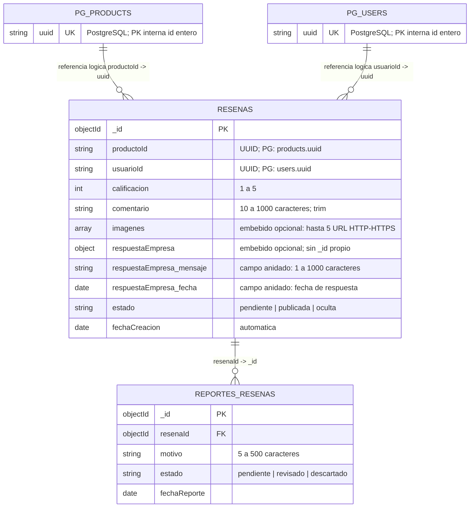

# ER documental MongoDB — APDAF SPORT

## Convenciones del diagrama

- `imagenes` y `respuestaEmpresa` están embebidos dentro de cada documento `resenas`.
- `respuestaEmpresa_mensaje` y `respuestaEmpresa_fecha` representan las rutas anidadas `respuestaEmpresa.mensaje` y `respuestaEmpresa.fecha`; no son campos planos ni colecciones aparte. `imagenes` contiene cadenas URL, no objetos ni archivos binarios.
- Las etiquetas `PG` distinguen referencias externas hacia PostgreSQL de la relación entre colecciones MongoDB. `productoId` y `usuarioId` son cadenas UUID que apuntan a `products.uuid` y `users.uuid`; no son claves foráneas impuestas por MongoDB. PostgreSQL conserva sus claves primarias internas enteras.
- `reportes_resenas.resenaId` referencia el `_id` de `resenas` dentro de MongoDB.
- `reportes_resenas` permanece como colección aparte porque sus documentos se crean, revisan y resuelven independientemente de la reseña.
- `_id` y `resenaId` son BSON `ObjectId`; las fechas son BSON `Date`. La relación representa una reseña con cero o varios reportes. La existencia del destino requiere control de la aplicación.
- `estrellas` es un virtual de Mongoose y no aparece como dato almacenado. Se omiten metadatos de Mongoose como `__v`.
