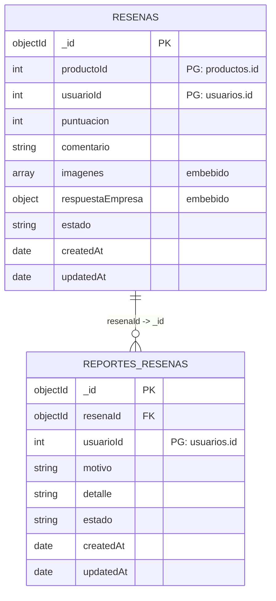

# ER documental MongoDB — APDAF SPORT

## Convenciones del diagrama

- `imagenes` y `respuestaEmpresa` están embebidos dentro de cada documento `resenas`.
- `productoId` y `usuarioId` no son claves foráneas de MongoDB: son referencias lógicas a PostgreSQL.
- `reportes_resenas.resenaId` referencia el `_id` de `resenas` dentro de MongoDB.
- `reportes_resenas` permanece como colección aparte porque sus documentos se crean, revisan y resuelven independientemente de la reseña.
