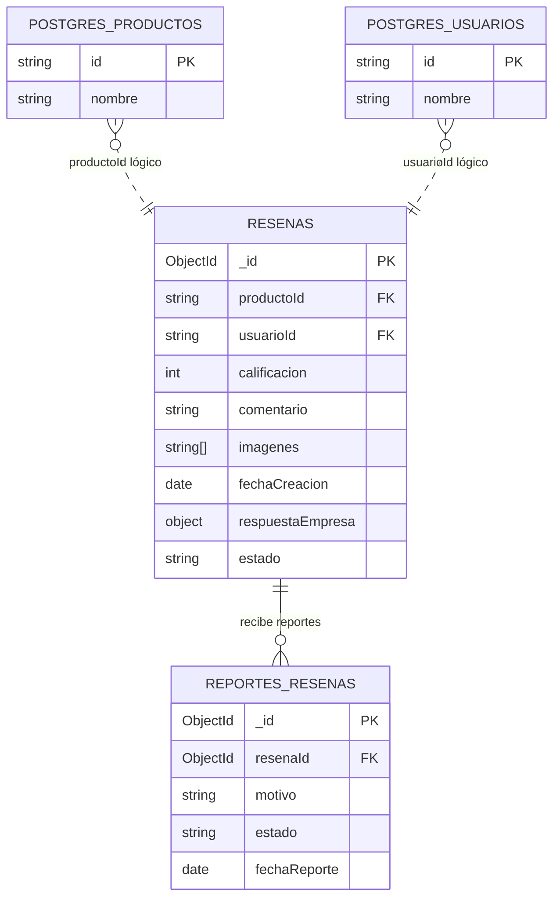

# Hito 2 — Workload y modelo documental

## 1. Workload de APDAF SPORT

Las frecuencias son estimaciones académicas, porque todavía no existen datos
reales de uso de APDAF SPORT.

| Actor | Operación | Lectura o escritura | Frecuencia estimada |
|---|---|---|---|
| Cliente | Crear una reseña de un producto | Escritura en `resenas` | 10 reseñas por día |
| Cliente | Consultar reseñas de un producto | Lectura de `resenas` | 80 consultas por día |
| Cliente | Consultar su historial de reseñas | Lectura de `resenas` filtrada por `usuarioId` | 10 consultas por día |
| Personal de APDAF SPORT | Responder una reseña | Escritura/actualización en `resenas.respuestaEmpresa` | 5 respuestas por día |
| Personal de APDAF SPORT | Moderar una reseña | Escritura/actualización en `resenas.estado` | 10 revisiones por día |
| Cliente o personal | Reportar una reseña | Escritura en `reportes_resenas` | 3 reportes por día |
| Personal de APDAF SPORT | Revisar reportes de reseñas | Lectura de `reportes_resenas` y de la reseña relacionada | 5 consultas por día |

Las operaciones principales de esta parte son crear y consultar reseñas, además
de revisar reportes. La colección `reportes_resenas` guarda el motivo, el estado
del reporte y la fecha en que fue creado.

## 2. Embeber o referenciar

| ¿Qué datos se embeben? | ¿Qué datos se referencian? | ¿Por qué se toma esta decisión? |
|---|---|---|
| `imagenes` y `respuestaEmpresa` dentro de `resenas`. | `productoId` y `usuarioId` son referencias lógicas a productos y usuarios de PostgreSQL. `reportes_resenas.resenaId` referencia a `resenas._id` dentro de MongoDB. | Las imágenes pertenecen directamente a la reseña y se consultan junto con ella. `respuestaEmpresa` es una respuesta propia de una reseña y puede no existir, por eso se mantiene como objeto embebido opcional. Los productos y usuarios ya tienen su información principal en PostgreSQL, así que no se duplica. Los reportes se mantienen en una colección separada porque pueden existir varios reportes para diferentes reseñas y necesitan su propio estado de revisión. |

### Justificación de los datos embebidos

- **`imagenes`:** es una lista de hasta cinco URLs asociadas a la reseña. Se
  consulta junto con el comentario y no necesita una colección independiente.
- **`respuestaEmpresa`:** contiene `mensaje` y `fecha`. Es opcional y pertenece
  directamente a la reseña que responde la empresa.

### Referencias entre bases

`productoId` y `usuarioId` no son documentos relacionados de MongoDB. Son
referencias lógicas a los identificadores de productos y usuarios almacenados en
PostgreSQL. El servicio puede validar o consultar esos identificadores en
PostgreSQL cuando sea necesario.

En MongoDB, `reportes_resenas.resenaId` guarda el `_id` de un documento de
`resenas`. Esta relación se puede consultar con `$lookup`; no se copia toda la
reseña dentro del reporte y se evita duplicar el comentario original.

## 3. Modelo documental de MongoDB

La base de datos es `apdaf_sport` y contiene dos colecciones:

- **`resenas`:** colección principal con la valoración, comentario, imágenes,
  respuesta de la empresa, fecha y estado.
- **`reportes_resenas`:** colección separada para registrar reportes y su
  seguimiento.

El validador actual de `resenas` acepta los estados `pendiente`, `publicada` y
`oculta`. Para `reportes_resenas`, los estados son `pendiente`, `revisado` y
`descartado`.

## 4. Diagrama ER de MongoDB

El diagrama distingue las referencias lógicas hacia PostgreSQL con líneas
discontinuas. La relación entre las dos colecciones de MongoDB se muestra con
línea continua.

La relación `RESENAS`–`REPORTES_RESENAS` representa
`reportes_resenas.resenaId → resenas._id`. Las relaciones con
`POSTGRES_PRODUCTOS` y `POSTGRES_USUARIOS` son referencias lógicas entre
MongoDB y PostgreSQL, no relaciones físicas dentro de MongoDB.

## 5. Revisión de nombres y reglas

El documento usa los nombres y reglas del playground
`docs/u2/grupo1.mongodb.js`. Antes de cerrar el hito, Daniel y Samuel deben
confirmar que las colecciones, tipos, estados y validaciones coincidan con lo
que quede implementado en la API. En especial, se debe confirmar el campo
`estado` de `resenas` y sus valores permitidos.
