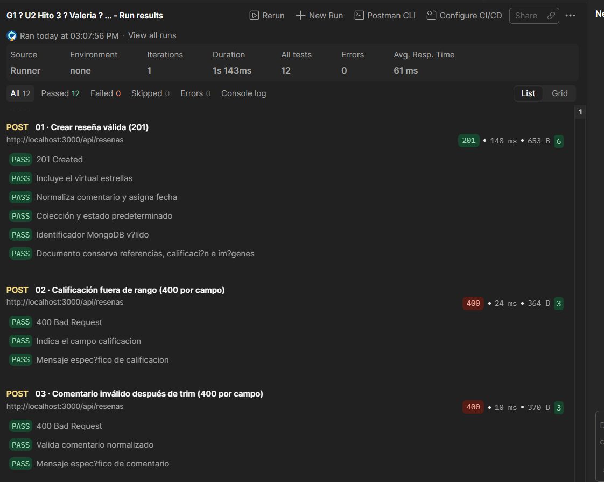

# Valeria: pruebas y evidencias del Hito 3

Revisión del 14 de noviembre de 2026. Seguimiento: [Issue #17](https://github.com/valemiii/Lab1_Mini_API/issues/17).
Entrega parcial: no se declara completa la entrega grupal.

## Estado actualizado después de la revisión final de Valeria

Esta sección sustituye los pendientes y estados históricos de las secciones posteriores.

- PR #24 integrado; documentos de Bri integrados por PR #26 y alineados con la implementación por PR #27. No siguen como borradores.
- [Informe de regresión Unidad 1](./valeria-unidad1-pruebas.json): 59 escenarios aprobados y cero fallos. Pruebas HTTP reales contra la API local en puerto 3011; no es una ejecución Postman ni Newman. Incluye autenticación, roles, perfiles, productos, categorías, lotes, reseñas PostgreSQL, pedidos, rollback, stock, historial y reportes. Solo se crearon y eliminaron datos identificables de esa ejecución; no se modificaron registros ajenos.
- Un primer intento quedó bloqueado por desconexión de la API en puerto 3000. La ejecución controlada posterior lo sustituye. Se corrigió la expectativa del auditor sobre token inválido: el middleware devuelve 403, no 401; el caso se repitió y aprobó sin modificar código.
- La auditoría comprobó un fallo de conexión MongoDB en un proceso separado: salida 1, mensaje controlado y ninguna escucha HTTP detectada.
- Playground de Daniel ejecutado en una base temporal aislada, eliminada al terminar: dos reseñas válidas, rechazos por `calificacion` y `estado`, dos reportes y dos resultados del `$lookup` con `$unwind`. El modelo Mongoose insertó correctamente sobre ese validador. No se ejecutaron los `drop()` contra `apdaf_sport`. Defecto menor comunicado en la revisión: el contador impreso de inserciones usa `.length` sobre `insertedIds` y muestra `undefined`; el conteo real fue dos. El código de Daniel no se modificó.
- Runner de Valeria: tres solicitudes, doce aserciones aprobadas, cero fallos y cero errores. Compass: captura real revisada y existencia del documento confirmada mediante consulta de lectura.
- La [guía de entorno](./preparacion-entorno.md#conflictos-con-servicios-docker-ya-existentes) documenta los conflictos de Compose y la alternativa local verificada. `docker compose config --quiet` pasa. No se afirma que `docker compose up -d` inicie todos los servicios en esta máquina: los puertos y un nombre de contenedor ya están ocupados.
- Valeria confirmó que Daniel y Samuel no habían revisado los documentos y autorizó su propia revisión final como sustitución. No se atribuye una aprobación a ellos.
- Hito 1 revisado y elegible para etiquetar sobre el commit final integrado. Hito 2 sigue pendiente de comparar las preguntas con la plantilla original del kit, que no está disponible en las fuentes revisadas.
- Hito 3 tiene pruebas y evidencias, pero `.env.example` publicado contiene marcadores y no una URI de ejemplo con `authSource=admin`. No se publica `u2-hito-3` mientras falte ese requisito. La regresión de Unidad 1 ya no está pendiente.
- Repositorio público; entrega en Moodle y acceso efectivo del docente sin evidencia. Los Issues #14 y #17 permanecen abiertos mientras tengan actividades pendientes.

## Registro histórico de preparación

Las secciones siguientes conservan el contexto de los primeros intentos; sus pendientes deben leerse junto con el estado actualizado anterior.

## Preparación y resultados reales

- Rama creada desde `main`, actualizado por avance rápido con `origin/main` tras `git fetch origin`. Base: `7f78795`.
- El POST de Samuel y el playground de Daniel están integrados. Se conserva PostgreSQL, Prisma y la Unidad 1.
- `npm ci --no-audit --no-fund`: finalizó correctamente (138 paquetes). Avisó de scripts de instalación de Prisma pendientes de autorización.
- Lockfile: mongoose 9.11.4 y validator 13.15.35. Las dependencias ya estaban fijadas a esas versiones exactas; no fue necesario cambiarlas.
- Sintaxis del arranque, modelo y servicio: correcta. Las tres solicitudes JSON y sus scripts Postman también tienen sintaxis válida. Esto no equivale a ejecutar la colección.
- Arranque comprobado: MongoDB en apdaf_sport y PostgreSQL mediante Prisma conectan antes de escuchar en puerto 3000.
- `.env` local configurado y excluido de Git; no se publica. Se usa PostgreSQL local en puerto 5433, base `lab2_apdaf`, y MongoDB existente en puerto 27018, base `apdaf_sport`.
- `docker compose up -d mongodb`: no pudo iniciarse inicialmente porque el motor no estaba activo; el intento restringido posterior encontró permisos insuficientes. No se borraron volúmenes ni se ejecutó el seed.
- `npm run dev`: no inició inicialmente porque faltaba generar Prisma. `npm run db:generate` después generó correctamente Prisma Client 6.19.3. El arranque posterior con `node src/server.js` terminó con código 1 por ausencia de `JWT_SECRET`, sin iniciar escucha HTTP.
- Docker Desktop se inició en segundo plano. El intento con acceso al motor creó el contenedor `grupal-mongodb-1`, su volumen y red, pero no pudo arrancarlo: el puerto 27018 ya pertenece a `espe-mongo`. No se detuvo ni modificó ese servicio; el nuevo contenedor quedó detenido. Resolver localmente usando la conexión existente autorizada o acordando otro puerto, sin borrar datos.
- Se cre? la base local `lab2_apdaf` con autorizaci?n y se aplicaron correctamente las siete migraciones. Se cre? un producto y un usuario de prueba mediante upsert, sin borrar datos ni ejecutar el seed destructivo. UUID existentes: producto `82b60b70-be8d-4b0c-a069-6ffe9f9622d6`, usuario `5ce094ea-0d6b-4831-97e4-f5d54d330629`.
- Valeria ejecut? las tres solicitudes en Postman Collection Runner: una iteraci?n, 12 aserciones aprobadas, 0 fallos y 0 errores. Respuestas 201, 400 y 400. Resultado confirmado visualmente en la captura real aportada por Valeria. No se ejecut? Newman ni regresi?n de la Unidad 1.
- Captura real de Compass aportada por Valeria y revisada visualmente: apdaf_sport.resenas, documento 6af8bf9d9bbc2b8750f14089, UUID de prueba, comentario normalizado y estado pendiente. Sin credenciales visibles.
- Repositorio público según GitHub API. El Issue #17 no tenía comentarios al revisarlo. No se verificó acceso efectivo del docente.

## Evidencias revisadas

## Colección y ejecución reproducible

Archivo: `postman/G1_U2_Hito3_Valeria.postman_collection.json`.
El kit no está disponible en el repositorio. Es una colección equivalente adaptada de la colección existente de Samuel, sin modificar su archivo.

1. Configurar un `.env` local con PostgreSQL, JWT_SECRET de al menos 32 caracteres y MongoDB. No publicarlo.
2. Iniciar Docker y ejecutar `docker compose up -d mongodb`. Ejecutar `npm ci`, `npm run db:generate` y `npm run dev`. No ejecutar el seed sobre la base compartida.
3. Consultar registros existentes en PostgreSQL: `SELECT uuid FROM products LIMIT 1;` y `SELECT uuid FROM users LIMIT 1;`. Configurar `productoId`, `usuarioId` y `baseUrl` en Postman. No exportar secretos.
4. Importar la colección de Valeria y ejecutar sus tres solicitudes juntas en Collection Runner. Alternativa con Newman instalado: `newman run postman/G1_U2_Hito3_Valeria.postman_collection.json --env-var baseUrl=http://localhost:3000 --env-var productoId=UUID_REAL_PRODUCTO --env-var usuarioId=UUID_REAL_USUARIO --reporters cli,json --reporter-json-export RUTA_LOCAL_RESULTADO.json`.
5. Confirmar 201 con `_id`, referencias, imágenes, calificación, fecha, estado, virtual `estrellas` y comentario sin espacios exteriores. Confirmar 400 con campo y mensaje específico para calificación 6 y comentario corto. Los dos casos inválidos reutilizan referencias válidas.
6. Revisar el informe antes de publicarlo: puede contener cuerpos e identificadores. Registrar conteos reales de solicitudes, aserciones y fallos; no sustituirlo por peticiones sueltas.
7. Abrir Compass con la conexión local, base `apdaf_sport`, colección `resenas`. Filtrar `{ _id: ObjectId("ID_DEVUELTO") }` usando `resenaCreadaId` de Postman. Mostrar documento, comentario normalizado y fecha; el virtual no se almacena en MongoDB. Guardar captura real como `docs/u2/valeria-compass-resenas.png`, sin URI ni datos personales innecesarios.

El POST MongoDB actual no exige token en su ruta; esta colección respeta esa configuración y no modifica controles. El módulo previo `/products/:id/reviews` es distinto, usa PostgreSQL y exige autenticación para crear. No se trasladan sus reglas automáticamente. La colección crea una reseña válida por ejecución y no elimina documentos ajenos.

## Pendientes externos: Bri, Issue #14

No se modificaron sus documentos ni el ER.

1. Crear `hito2.md` con workload: actor, operación, lectura/escritura y frecuencia; incluir creación/consulta de reseñas y revisión de reportes. Identificar estimaciones.
2. Completar tabla de embeber/referenciar con las tres preguntas exactas de la plantilla, no disponible aquí.
3. Justificar `imagenes` y `respuestaEmpresa` embebidos.
4. Explicar UUID lógicos `productoId` y `usuarioId` hacia PostgreSQL y `reportes_resenas.resenaId → resenas._id` dentro de MongoDB.
5. Elaborar y enlazar ER MongoDB con embebidos, reportes aparte y referencias externas distinguibles.
6. Corregir Hito 1: `clienteId` numérico → `usuarioId` UUID; `productoId` numérico → UUID; `fecha` → `fechaCreacion`; `respuestaNegocio` → `respuestaEmpresa`.
7. Alinear la descripción de reportes: el playground implementa moderación con motivo/estado, no resultados de análisis.
8. Revisar nombres, tipos y reglas con Daniel y Samuel.

Estos pendientes no bloquean ejecutar Postman, capturar Compass o publicar este PR si el entorno funciona.

## Coordinación y cierre pendiente de Valeria

- Compartir con Samuel y Daniel la disponibilidad real de MongoDB y UUID existentes cuando se confirme el entorno. No se enviaron mensajes ni comentarios externos.
- Confirmar con Samuel el alcance de autenticación de `/api/resenas`, que actualmente acepta `usuarioId` del cuerpo sin middleware de autenticación; no se cambió su ruta.
- Daniel usa validador BSON `int` para calificación; Samuel usa Number entero de Mongoose. Verificar compatibilidad con la colección validada al ejecutar de verdad. No se ejecutó el playground porque elimina las dos colecciones de práctica al comenzar.
- No se confirmó ningún fallo funcional mediante ejecución de bases; las observaciones anteriores quedan para sus responsables, sin completar su implementación.
- Runner y captura de Compass completados por Valeria y revisados visualmente. Queda pendiente comprobar la funcionalidad de la Unidad 1.
- No hay etiquetas locales ni remotas `u2-hito-1`, `u2-hito-2` o `u2-hito-3` al revisar. No se crearon etiquetas: faltan verificaciones y documentación. Tras merge, verificar el commit final y publicar `u2-hito-3` solo cuando esté completo; Hitos 1 y 2 también requieren revisión de sus entregables antes de etiquetar.
- PR borrador con `Refs #17`, sin cerrar el Issue y sin merge automático. Enviar manualmente el enlace en Moodle; no se realizó entrega.
