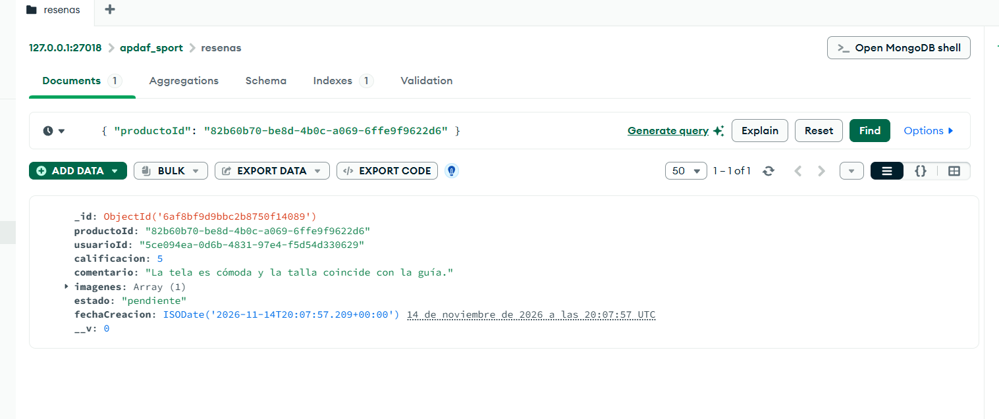

# Valeria: pruebas y evidencias de U2 · Parte 1

Seguimiento: [Issue #14](https://github.com/valemiii/Lab1_Mini_API/issues/14) y [Issue #17](https://github.com/valemiii/Lab1_Mini_API/issues/17). Revisión del 14 de noviembre de 2026. La entrega sigue pendiente de integración, etiquetas faltantes y publicación en la plataforma.

## Verificaciones nuevas

- Comparación real con `C:\Users\Lenovo\Downloads\LabU2_Kit.zip`: tablas de Hitos 1 y 2 y los tres casos obligatorios de la colección de Hito 3. Se conservan dos casos adicionales de la colección anterior. No se implementan Hitos 4 a 6.
- `npm ci --no-audit --no-fund`: 138 paquetes instalados respetando el lockfile. Avisó de scripts pendientes de autorización; `npm run db:generate` se ejecutó explícitamente y generó Prisma Client 6.19.3. La primera descarga del motor falló en el entorno restringido; el reintento con red habilitada funcionó.
- `npm ls mongoose validator`: mongoose 9.11.4 y validator 13.15.35.
- `docker compose config --quiet`: código 0. Docker estaba detenido al comenzar; se inició Docker Desktop. Se reutilizaron `espe-mongo` y `espe-postgres`, sin cambiar puertos, configuración local, semillas ni volúmenes.
- API propia con `PORT=3012 node src/server.js`: conexión MongoDB a `apdaf_sport`, conexión PostgreSQL con Prisma y después escucha HTTP, en ese orden. `.env` no se modificó y continúa excluido de Git.
- **Newman real:** cinco solicitudes, 20 aserciones, cero fallos. Respuestas 201, 400, 400, 400 y 400. Comprueba `_id`, estrellas, recorte del comentario, referencias, imágenes, fecha, estado predeterminado, cuatro mensajes required y mensajes exactos de validación propia y enum. [Informe completo](./valeria-newman-parte1.json). Esta ejecución creó una reseña; no eliminó documentos de las evidencias.
- Playground ejecutado como archivo UTF-8 con `mongosh --file` en **apdaf_u2_playground_test**: dos reseñas válidas, dos rechazos con campos `calificacion` y `estado`, dos reportes y dos resultados de `$lookup` con `$unwind`. Los dos contadores imprimen 2. El primer intento mediante REPL interpretó mal la agregación multilínea; la ejecución como archivo lo sustituye. No se ejecutaron `drop()` contra `apdaf_sport`.
- Mongoose guardó otra reseña sobre el validador BSON de la base aislada: entero compatible, hook y virtual correctos. El informe registra tres reseñas y dos reportes después de esa prueba. La repetición final del playground, tras reforzar la detección de una aceptación inesperada, dejó dos reseñas y dos reportes en la base de pruebas reservada.
- Fallos de conexión probados en procesos separados: MongoDB no disponible y PostgreSQL no disponible producen salida 1 sin ejecutar escucha HTTP. Unidad 1: `GET /api/products` devolvió 200 y un producto mediante Prisma/PostgreSQL. [Informe de estas comprobaciones con Node.js](./valeria-verificacion-parte1.json); no se atribuyen a Postman.
- ER revisado: embebidos dentro de `RESENAS`, reportes separados y cajas PostgreSQL identificadas como referencias lógicas. `.env.example` contiene ejemplos locales, no secretos de Supabase.

## Resultados previos conservados

Antes de esta revisión, Valeria aportó capturas reales de Runner (tres solicitudes, 12 aserciones aprobadas) y Compass. Esas capturas corresponden a la colección anterior, **no** a las cinco solicitudes actuales. No se dispone de una nueva captura real del Runner; se conserva la anterior sin editar y se publica el informe Newman nuevo.

La [regresión anterior de Unidad 1](./valeria-unidad1-pruebas.json) registró 59 escenarios aprobados mediante HTTP, no Postman. No se repitió completa: esta revisión ejecutó la lectura representativa descrita arriba. Los PR #24, #26, #27 y #28 ya estaban integrados. Las revisiones atribuidas previamente a Valeria se conservan como antecedentes; no se atribuye una revisión nueva a Daniel ni a Samuel.

## Capturas históricas




## Reproducir la colección

1. Configurar `.env` local a partir del ejemplo, usando las credenciales del servicio existente. No sobrescribir una configuración local válida. Iniciar Docker y los servicios necesarios según [preparacion-entorno.md](./preparacion-entorno.md). Ejecutar `npm ci`, `npm run db:generate` y `npm run dev`; no usar semillas destructivas.
2. Consultar PostgreSQL: `SELECT uuid FROM products LIMIT 1;` y `SELECT uuid FROM users LIMIT 1;`. Configurar `productoId`, `usuarioId` y `baseUrl` en la colección. Los UUID usados en la ejecución nueva fueron producto `82b60b70-be8d-4b0c-a069-6ffe9f9622d6` y usuario `5ce094ea-0d6b-4831-97e4-f5d54d330629`, existentes en el PostgreSQL local; no se garantiza que existan en otra instalación.
3. Ejecutar las cinco solicitudes en Collection Runner, o usar el siguiente comando desde PowerShell (ajustar puerto y UUID):

```powershell
npm exec --yes --package=newman -- newman run postman/G1_U2_Hito3_Valeria.postman_collection.json --env-var baseUrl=http://localhost:3012 --env-var productoId=82b60b70-be8d-4b0c-a069-6ffe9f9622d6 --env-var usuarioId=5ce094ea-0d6b-4831-97e4-f5d54d330629 --reporters cli,json --reporter-json-export docs/u2/valeria-newman-parte1.json
```

Cada ejecución crea una reseña válida. Los casos inválidos usan `detalles` con `campo` y `mensaje`, según el contrato actual de la API. El caso de validación propia usa UUID sintácticamente válidos para que se evalúen `calificacion: 2.5` y `estado: "invalido"` antes de consultar PostgreSQL. El POST no exige token actualmente; no se cambió la API.

Para una captura nueva real, ejecutar las cinco solicitudes en Postman Runner y guardar su resultado. En Compass consultar `apdaf_sport.resenas` por el `_id` devuelto; `estrellas` no se almacena. No sustituir capturas por imágenes fabricadas ni incluir credenciales.

## Integración, etiquetas y entrega pendientes

Consulta remota durante esta revisión: `u2-hito-1` existe y apunta al commit `ded1e768400d815fe47e4385237806c4301bb7ce`; no se movió. `u2-hito-2` y `u2-hito-3` no existen. Las casillas marcadas del Issue #17 no constituyen evidencia de etiquetas ni de entrega en Moodle.

Después de integrar el PR y verificar la rama principal, ejecutar solamente para etiquetas que continúen ausentes:

```powershell
git switch main
git fetch origin
git pull --ff-only origin main
git status --short
git ls-remote --tags origin 'u2-hito-*'
# Confirmar que main contiene el PR y que las pruebas siguen pasando.
git tag -a u2-hito-2 -m "U2 Hito 2 verificado tras integrar Parte 1"
git tag -a u2-hito-3 -m "U2 Hito 3 verificado tras integrar Parte 1"
git push origin u2-hito-2 u2-hito-3
```

No recrear ni reemplazar `u2-hito-1`, ni retrofechar etiquetas. Falta realizar la integración (sin merge automático), publicar las dos etiquetas cuando corresponda y entregar el enlace en la plataforma. No se verificó acceso efectivo del docente ni fecha límite. Si se exige una captura actual de Runner, debe obtenerse mediante la ejecución real indicada arriba.
